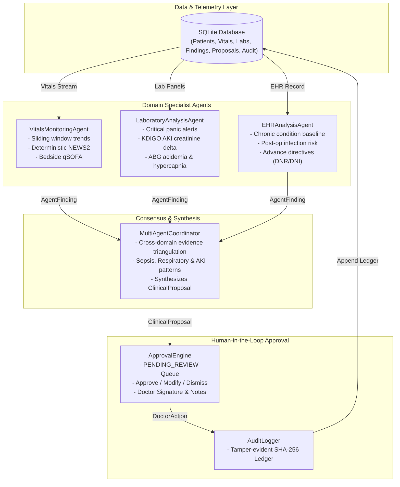

# MediAgent: Clinical Monitoring & Decision-Support Simulation System

> **CLINICAL SAFETY DISCLAIMER**  
> MediAgent is developed strictly for hackathon simulation, algorithmic research, and clinical decision support (CDS) exploration.  
> **It is NOT a certified medical device and must never be used as a primary diagnostic tool, autonomous triage system, or for unilateral prescription of medical therapy.**  
> All patient records, telemetry, and laboratory findings in this repository are **100% synthetic**.

---

## 1. Overview & Vision

**MediAgent** is a multi-agent AI-powered clinical surveillance and decision-support simulation system. It continuously monitors high-acuity ward and ICU synthetic patients, computes standardized clinical deterioration indices (NEWS2, qSOFA, KDIGO), identifies physiological anomalies, coordinates domain specialist findings into auditable evidence bundles, and routes clinical proposals to attending physicians via a strict **Human-in-the-Loop (HITL)** approval workflow.

### Core Architectural Pillars
1. **Fully Functional Offline Core:** Works without any external cloud API. Agents use deterministic medical rules, time-series anomaly detection, and cross-domain consensus logic. (Gemini LLM synthesis is an optional extension).
2. **Deterministic Clinical Guardrails:** Alert thresholds and composite scores are calculated using standardized, documented clinical protocols:
   - **NEWS2 (National Early Warning Score 2)** — Royal College of Physicians (RCP London 2017).
   - **qSOFA / Sepsis-3 Criteria** — Society of Critical Care Medicine & ESCICM (JAMA 2016).
   - **Surviving Sepsis Campaign (SSC 2021)** — Resuscitation bundles and lactate clearance.
   - **KDIGO Acute Kidney Injury Staging** — Kidney Disease: Improving Global Outcomes.
   - **British Thoracic Society (BTS)** — Emergency oxygen guidelines for chronic hypercapnia (Scale 2 target 88–92%).
3. **Auditable Evidence Bundles:** Agents do not hallucinate medical conclusions. Every finding provides an explicit evidence packet:
   $$\text{Evidence} = \{\text{Metric}, \text{Observed Value}, \text{Baseline}, \Delta\text{ Shift}, \text{Guideline Citation}\}$$
4. **Physician-in-the-Loop Governance:** AI proposals are restricted to `PENDING_REVIEW` until an authorized doctor explicitly executes an `APPROVED`, `MODIFIED`, or `DISMISSED` action with clinical documentation.
5. **Cryptographic Audit Trail:** Every event, finding, score, and physician action is written to an immutable SQLite audit ledger signed with sequential SHA-256 hashes.

---

## 2. Multi-Agent System Architecture (Phase 2)



---

## 3. Directory Structure

```text
mediagent/
├── README.md                          # Project documentation and architectural overview
├── requirements.txt                   # Project dependencies (Pydantic, Pandas, Pytest, Plotly, Streamlit)
├── run_phase1.py                      # Phase 1 verification script (Data & simulation)
├── run_phase2.py                      # Phase 2 verification script (Multi-agent intelligence)
├── config/
│   ├── clinical_rules.yaml            # Declarative thresholds for NEWS2, qSOFA, labs
│   └── scenarios.yaml                 # Scenario configurations and metadata
├── data/
│   └── mediagent.db                   # Generated SQLite database (created on first run)
├── mediagent/
│   ├── __init__.py                    # Clinical safety disclaimer and package metadata
│   ├── models/                        # High-assurance Pydantic data schemas
│   │   ├── __init__.py
│   │   ├── patient.py                 # Patient, Comorbidity, Medication, BaselineVitals
│   │   ├── telemetry.py               # VitalSigns, LabItem, LabResult, LabPanelType
│   │   ├── finding.py                 # EvidenceBundle, AgentFinding, FindingSeverity
│   │   └── proposal.py                # ClinicalProposal, DoctorAction, ProposedIntervention
│   ├── storage/                       # Persistence and audit layers
│   │   ├── __init__.py
│   │   ├── db.py                      # SQLite connection, schema DDL, WAL configuration
│   │   ├── patient_repo.py            # Patient, telemetry, lab, finding, and proposal queries
│   │   └── audit_logger.py            # SHA-256 tamper-evident clinical audit ledger
│   ├── simulation/                    # Synthetic patient trajectory simulation
│   │   ├── __init__.py
│   │   ├── scenarios.py               # 3 Clinical scenarios (Stable, Sepsis, Respiratory)
│   │   └── generator.py               # Telemetry generator with physiological jitter
│   ├── engine/                        # Deterministic clinical risk calculators
│   │   ├── __init__.py
│   │   ├── news2.py                   # Royal College of Physicians NEWS2 algorithm
│   │   └── qsofa.py                   # Sepsis-3 qSOFA bedside assessment
│   ├── agents/                        # Domain specialist agents
│   │   ├── __init__.py
│   │   ├── base_agent.py              # Abstract BaseClinicalAgent
│   │   ├── vitals_agent.py            # VitalsMonitoringAgent
│   │   ├── lab_agent.py               # LaboratoryAnalysisAgent
│   │   └── ehr_agent.py               # EHRAnalysisAgent
│   ├── coordinator/                   # Multi-agent consensus & proposal generator
│   │   ├── __init__.py
│   │   └── coordinator.py             # MultiAgentCoordinator
│   └── workflow/                      # Human-in-the-loop doctor governance
│       ├── __init__.py
│       └── approval_engine.py         # ApprovalEngine (Approve, Modify, Dismiss)
└── tests/                             # Comprehensive test suite
    ├── __init__.py
    ├── test_models.py                 # Data validation and constraints
    ├── test_db.py                     # SQLite CRUD and repository operations
    ├── test_scenarios.py              # 24h trajectory clinical fidelity tests
    ├── test_clinical_scores.py        # NEWS2 and qSOFA scoring tests
    ├── test_vitals_agent.py           # VitalsMonitoringAgent independent tests
    ├── test_lab_agent.py              # LaboratoryAnalysisAgent independent tests
    ├── test_ehr_agent.py              # EHRAnalysisAgent independent tests
    ├── test_coordinator.py            # MultiAgentCoordinator integration tests
    └── test_workflow.py               # ApprovalEngine doctor review tests
```

---

## 4. How to Run Phase 2

### Step 1: Run Automated Tests
Execute the complete test suite:
```powershell
.\.venv\Scripts\pytest -v tests/
```

### Step 2: Run the Phase 2 End-to-End Demonstration Script
Execute the full multi-agent deliberation, cross-domain triangulation, and physician governance pipeline:
```powershell
.\.venv\Scripts\python.exe run_phase2.py
```

### Script Execution Highlights:
1. **Initializes & Seeds Database:** 24 hours of telemetry and episodic labs for all 3 clinical scenarios.
2. **Runs Specialist Agents:**
   - `VitalsMonitoringAgent`: Flags NEWS2 escalation, qSOFA positive criteria, hemodynamic shock, tachypnea, and temperature anomalies.
   - `LaboratoryAnalysisAgent`: Flags critical lactate dysoxia ($\ge 4.0\text{ mmol/L}$), leukocytosis, thrombocytopenia, KDIGO AKI creatinine jumps, and ABG acidemia/hypercapnia.
   - `EHRAnalysisAgent`: Integrates COPD target SpO2 Scale 2 baseline, post-surgical infection vulnerability, active antimicrobial regimens, and advance directives (`DNR/DNI`).
3. **MultiAgentCoordinator Triangulation:**
   - Synthesizes `ClinicalProposal`s matching Surviving Sepsis guidelines, BTS hypercapnic protocols, and routine ward surveillance.
4. **Physician Sign-Off Workflows:**
   - Doctor approves Sepsis proposal (`PAT-002`) with resuscitation notes.
   - Doctor modifies Respiratory failure proposal (`PAT-003`) with custom BiPAP trial settings respecting DNI advance directive.
   - Doctor dismisses Stable patient proposal (`PAT-001`) with ambulation notes.
5. **Audit Verification:** Verifies SHA-256 signatures for all events in the SQLite ledger.
